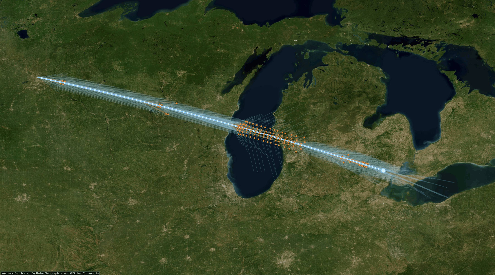
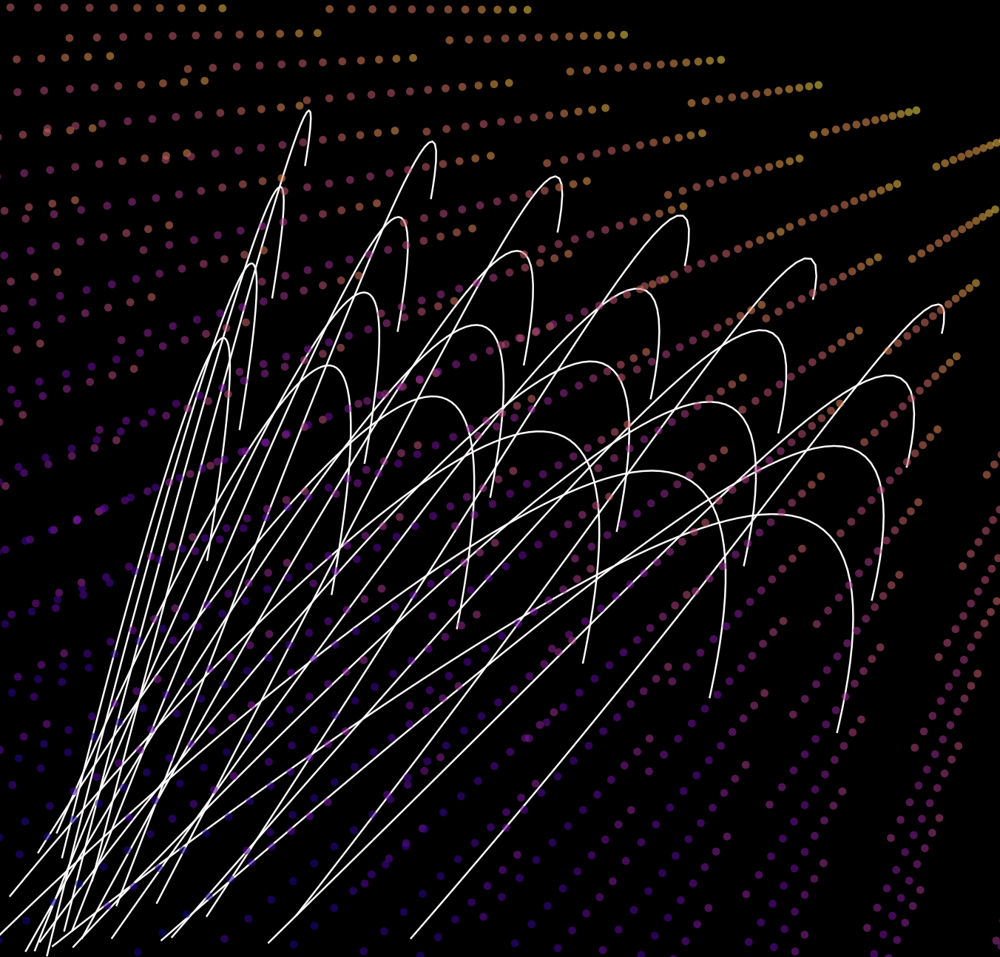
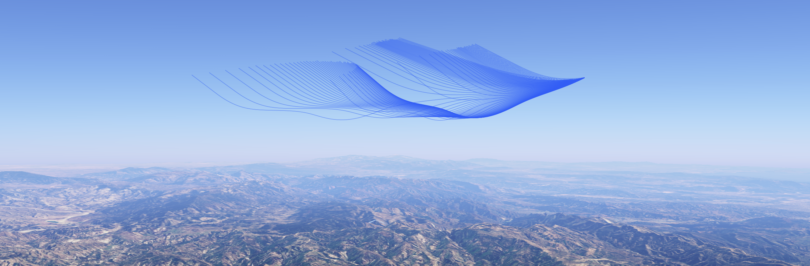

# Mach Cutoff

Mach Cutoff is a Python simulator for a question about supersonic flight: can sound from an aircraft turn upward before it reaches the ground? The simulator traces acoustic rays through NOAA weather data along a prescribed flight path.

## Table of Contents

- [Overview](#overview)
- [Flight Path](#flight-path)
- [Atmosphere](#atmosphere)
- [Ray Tracing](#ray-tracing)
- [Run a Flight](#run-a-flight)

## Overview



On this Minneapolis–Saint Paul to Detroit flight, the bright line is the aircraft track. The thin lines are acoustic rays. Orange points mark places where a ray intersected the modeled surface.

## Flight Path

Each waypoint specifies latitude, longitude, altitude, and a UTC arrival time. The aircraft follows a great-circle arc between waypoints. Changing the arrival time changes the segment speed, which affects the angle at which the rays leave the aircraft. [Flight model](mach_cutoff/flight/aircraft.py)

This repository contains the open-loop version, which follows the supplied schedule. The April routing study used an earlier version with aircraft guidance.

## Atmosphere

The weather loader reads temperature, pressure, humidity, and wind from NOAA HRRR. The following lines estimate the speed of sound in moist air. The simulator then adds the wind component along the configured direction. [Atmosphere model](mach_cutoff/atmosphere/acoustics.py)

```python
r_moist = R_DRY_AIR * (1.0 + 0.61 * specific_humidity)
return np.sqrt(GAMMA_DRY_AIR * r_moist * t)
```



In this prototype, the colored points sample the refractive index. The white curves show how rays change direction as they cross the field.

## Ray Tracing



These rays left the same point at different angles. Several descend, reach a low point, and climb again. The solver follows each path in steps and checks for an intersection with the WGS84 ellipsoid. A ray can also leave the weather grid or reach the step limit, so its final altitude alone cannot establish that it turned upward. [Ray tracer](mach_cutoff/core/raytrace.py)

## Run a Flight

[Download the Houston Intercontinental–Miami flight (KML)](https://github.com/lbarks27/Mach-Cutoff/releases/download/iah-mia-demo/iah_mia_cutoff.kml?format=lines) and open it in Google Earth. The flight path and all rays appear together as static lines. The 75-minute cruise runs directly from IAH to MIA at 17,000 m.

The model emitted 16 rays at each of 41 positions along the route on January 15, 2025. All 328 initially downward rays turned upward above the surface. The KML includes all 656 rays, with zero modeled ground hits.

To run the same [flight profile](examples/waypoints_iah_mia_cutoff.json) with its [weather and ray settings](examples/config_iah_mia_cutoff.json), use Python 3.12 and ecCodes. From the repository root, run

```sh
python3.12 -m venv .venv
.venv/bin/python -m pip install '.[hrrr]'
.venv/bin/mach-cutoff --waypoints examples/waypoints_iah_mia_cutoff.json --config examples/config_iah_mia_cutoff.json --output-dir outputs/iah_mia_cutoff
```

The first run downloads the weather files. Open `outputs/iah_mia_cutoff/google_earth_overlay.kml` in Google Earth to see the result.
